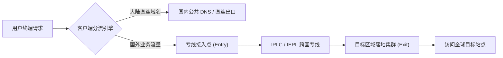
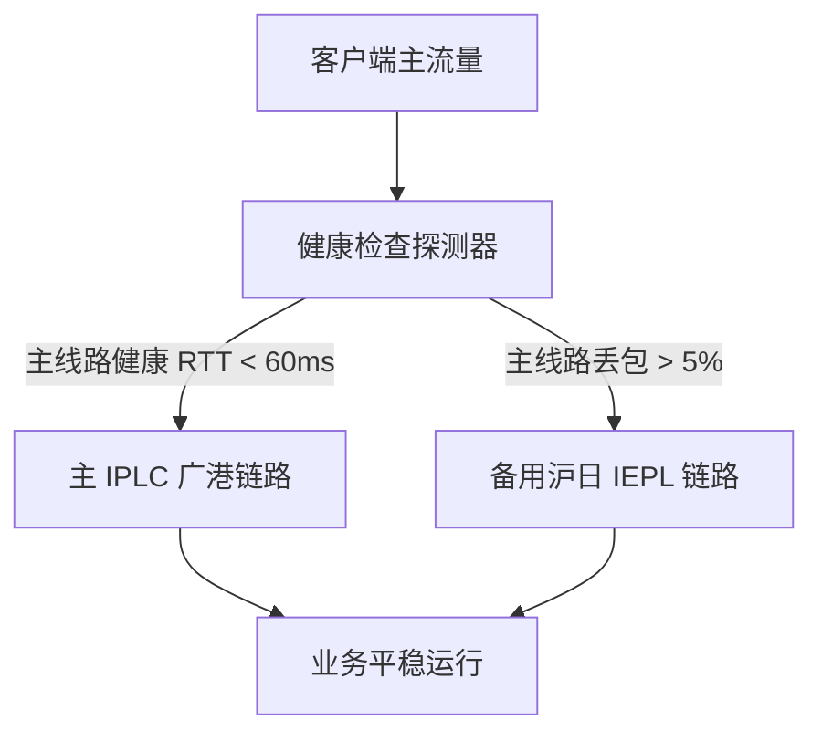

在日益复杂的全球互联网接入环境中，拥有稳定、高速且低延迟的网络加速通道，已经成为开发者、科研人员以及跨境出海业务的基本生产力工具。本文立足真实网络测试数据与工程实践，系统梳理主流网络协议特性、节点延迟与吞吐量评估模型，并提供全流程选购与客户端配置策略。

<!-- more -->


## 核心测评维度与质量基准

衡量一个网络节点服务是否优质，绝不能仅仅看单次跑分峰值，而需要从多维度的长期稳定性指标进行综合研判：

- **可用率（SLA）**：月度节点连通可用时间是否保持在 99.9% 以上。
- **峰值带宽与保底吞吐**：晚高峰时段（20:00 - 23:00）的实际流媒体 4K/8K 码率承载能力。
- **拓扑专线优势**：是否部署真正的 IPLC / IEPL 专线，物理规避公网拥塞与抖动。
- **客户端跨平台生态**：是否原生支持 Clash Meta / Sing-box / Shadowrocket / Surge 等通用内核。

> 一个高水准的网络节点服务，应当在无感知的状态下顺畅运行：负责底层链路传输与智能分流，把纯粹的流畅体验留给日常业务。

### 协议性能与安全性解析

当前主流加密与传输协议在吞吐效率、握手时延和伪装能力上各有千秋：

- **Hysteria 2**：基于标准 UDP/QUIC 协议开发，在恶劣丢包网络环境下依然能榨干带宽极限。
- **Vless + Reality**：直接借助真实大厂 TLS 证书作为掩护，具备极强的协议伪装与隐蔽性。
- **Shadowsocks 2022**：极简对称加密，单核心 CPU 吞吐性能出众，特别适合高并发软路由网关。
- `const protocol = 'hysteria2'` 是针对跨洲高延迟高丢包链路的极佳选择。

---

## 节点网络拓扑与选购清单

在规划日常加速方案时，建议区分主要应用场景并制定清单：

- [X] 明确核心业务需求（流媒体解锁、大文件传输或低延迟竞技游戏）
- [X] 测试本地宽带运营商（电信、联通、移动）的跨境出口路由
- [X] 部署主备高可用分流规则
- [ ] 定期校验节点健康度与协议可用性

### 链路架构与排版示例

高质量的跨境网络链路通常由入口接入点、跨国专线传输通道以及落地出口集群组成。下图直观展示了从终端请求到目标服务器的端到端分层处理流：


在移动端和窄屏设备上，图表与界面均支持等比响应缩放与图片灯箱查看：


### 为什么低延迟网络需要专线接入

当骨干网受到公网流量突发挤压时，公网动态 BGP 线路常伴随丢包率上升。而内网专线（IPLC）在物理层面上隔离了公网路由波动，能提供恒定的传输时延，保证关键 API 调用的毫秒级响应。

> **提示**：可通过本站顶部搜索框快速检索不同地区（如香港、日本、新加坡、美国）的专线节点延迟实测数据。

## 客户端核心配置代码片段

主流现代客户端均支持分流规则与多节点策略组配置。以下展示标准 Sing-box / Clash 内核的核心配置结构：

```json
{
  "outbounds": [
    {
      "type": "selector",
      "tag": "select-node",
      "outbounds": ["hk-iplc-01", "sg-iplc-01", "jp-bgp-01", "direct"]
    },
    {
      "type": "urltest",
      "tag": "auto-fastest",
      "outbounds": ["hk-iplc-01", "sg-iplc-01", "jp-bgp-01"],
      "url": "https://cp.cloudflare.com/generate_204",
      "interval": "3m",
      "tolerance": 50
    }
  ]
}
```

也可以通过终端脚本快速进行网络诊断与路由跟踪：

```bash
# 测试节点目标地址延迟与丢包率
mtr -r -c 50 --report-wide hk-iplc-01.jichangtuijian.lat

# 验证当前外网出口 IP 与归属地地理信息
curl -fsSL https://ipinfo.io/json
```

针对高级路由分流引擎，一行典型的规则过滤函数如下：

```ts
const prioritizedNodes = nodes.filter((node) => node.region === 'HK' && node.latency < 45).sort((a, b) => a.latency - b.latency);
```

## 主流节点协议综合对比

在选择适合自身网络环境的服务商时，参考以下客观指标对比表：

| 协议类型 | 传输层基础 | 抗丢包表现 | 典型落地场景 |
| :------- | :--------- | :--------- | -----------: |
| Hysteria 2 | UDP (QUIC) | 极佳 (30%+ 仍满速) | 晚高峰大流量下载、4K 视频 |
| Vless-Reality | TCP + TLS | 良好 (依赖公网质量) | 长连接工作流、代码仓库拉取 |
| SS-2022 | TCP / UDP | 中等 (轻量快速) | 软路由主网关、低功耗设备 |
| Trojan-Go | TCP (TLS) | 良好 | 标准 HTTPS 伪装穿透 |

### 常见跨国专线质量评级

下面对主流跨境传输干线类型进行横向对比，帮助您在选购时避开虚假宣传：

| 专线类型 | 物理传输通道 | 平均抖动 (Jitter) | 晚高峰抗拥塞能力 | 适合业务场景 |
| :--- | :--- | :--- | :--- | :--- |
| `广港 IPLC` | 深圳/广州直连香港点对点内网 | < 2 ms | 极强（不受公网拥堵影响） | 毫秒级高频交易、低延迟竞技游戏 |
| `沪日 IEPL` | 上海海缆直达东京数据中心 | < 3 ms | 极强 | 亚太核心区业务研发与协同 |
| `公网 BGP 直连` | 多线动态 BGP 公网路由 | 15 - 50 ms | 中等（受公网晚高峰波动） | 日常网页浏览与文档查阅 |
| `CDN Anycast 中继` | 分布式边缘反向代理 | 10 - 30 ms | 良好 | 静态资源加速与全球业务分发 |

## 网络测速与吞吐量评估数学模型

节点在丢包网络下的吞吐上限不仅取决于标称带宽，还受传输控制协议的滑动窗口与往返时延（RTT）约束。根据经典的 Mathis 吞吐量估算公式：

$$
\text{Throughput} \le \frac{\text{MSS}}{\text{RTT} \cdot \sqrt{p}}
$$

其中 $\text{MSS}$ 为最大报文段长度，$\text{RTT}$ 为往返延迟时间，$p$ 为链路丢包率。由此可见，当往返时延 $\text{RTT}$ 降低时，即便面临微小丢包，有效吞吐量也将成倍提升。

在多路径分流权重分配中，通常采用 Softmax 概率分布对节点进行自适应调度：

$$
P(\text{node}_i) = \frac{e^{-\lambda \cdot \text{latency}_i}}{\sum_{j=1}^{n} e^{-\lambda \cdot \text{latency}_j}}
$$

## 智能分流与调度链路流程图

使用标准代码围栏即可直接渲染 Mermaid 架构图，帮助清晰理解请求从本地分流到跨国传输的完整流程：



### 高可用自动容灾架构图

当主专线发生短暂告警时，调度系统将毫秒级平滑切换到备用链路：



## 常见问题与补充说明

<details>
  <summary>点击展开：为什么有时测速延迟很低，但实际视频加载仍有卡顿？</summary>

  测速工具往往测试的是 ICMP Ping 握手往返延迟或小数据包吞吐，而实际流媒体播放涉及 TCP 慢启动、TLS 握手协商、服务端并发线程数限制以及 CDN 分配节点等综合因素。选择具备大带宽专线与优质流媒体解锁支持的节点服务，才能保证高码率持续缓冲稳定。

</details>

> [!NOTE]
> 本站所有测评数据均基于自动化测速集群多节点 24 小时不间断采集，力求呈现最真实、客观的网络体验。

## 结语

选择一条高速、稳定的网络加速通道，核心在于认清自身网络需求，挑选具备真正专线承载、跨地域容灾以及多协议兼容的优质节点服务。本站将持续跟进最新网络协议与评测数据，为您提供最具价值的技术参考。
